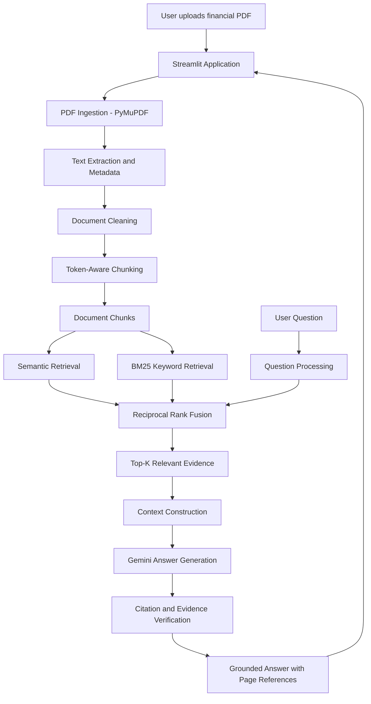

<div align="center">

# FinDoc AI — Financial Document Intelligence & Search Platform

**Ask questions. Retrieve financial evidence. Get grounded answers.**

An AI-powered financial document intelligence platform that transforms lengthy financial PDFs into searchable, evidence-backed knowledge.

[](https://github.com/Rauof-Qadir/Financial-Doc.-Search-Platform)


</div>
---

## Table of Contents

- [Overview](#overview)
- [The Problem](#the-problem)
- [Key Features](#key-features)
- [System Architecture](#system-architecture)
- [How It Works](#how-it-works)
- [Technology Stack](#technology-stack)
- [Project Structure](#project-structure)
- [Getting Started](#getting-started)
- [Configuration](#configuration)
- [Running the Application](#running-the-application)
- [Example Questions](#example-questions)
- [Evaluation and Testing](#evaluation-and-testing)
- [Security and Responsible AI](#security-and-responsible-ai)
- [Current Limitations](#current-limitations)
- [Future Improvements](#future-improvements)
- [Contributing](#contributing)
- [Author](#author)

---

## Overview

**FinDoc AI** is a financial document intelligence and question-answering platform designed to make complex financial reports easier to explore and understand.

Financial documents such as annual reports, 10-K filings, earnings reports, and financial statements contain valuable information distributed across hundreds of pages. Finding a specific figure, explanation, or disclosure manually can be time-consuming.

FinDoc AI addresses this problem through a document-processing and Retrieval-Augmented Generation (RAG) workflow.

Users can upload a financial PDF, ask natural-language questions, retrieve relevant document passages, and receive AI-generated answers supported by page-level references.

The platform combines:

- PDF text extraction and document processing.
- Token-aware document chunking.
- Semantic search using Sentence Transformers.
- BM25 keyword retrieval.
- Reciprocal Rank Fusion (RRF) for combining retrieval rankings.
- Gemini-powered answer generation.
- Page-level citations and evidence inspection.
- Automated testing of core components.

**Core principle:** The document is the source of truth. The language model should answer from retrieved evidence rather than inventing financial information.

## The Problem

Traditional financial document analysis often involves:

1. Opening large PDF reports.
2. Searching manually for financial terms and figures.
3. Reading multiple pages to understand context.
4. Comparing information across different sections.
5. Verifying where a financial statement or figure originated.

A conventional keyword search can miss semantically relevant passages. A language model without document retrieval can generate unsupported or inaccurate answers.

FinDoc AI brings document retrieval and language generation together to provide a more traceable workflow.

## Key Features

| Feature               | Description                                                                   |
| --------------------- | ----------------------------------------------------------------------------- |
| PDF ingestion         | Extracts text and page information from financial PDF documents.              |
| Document processing   | Cleans extracted content and prepares it for retrieval.                       |
| Token-aware chunking  | Splits documents into manageable passages while considering token boundaries. |
| Semantic retrieval    | Uses Sentence Transformers to retrieve contextually relevant passages.        |
| BM25 retrieval        | Finds relevant passages using keyword-based ranking.                          |
| Hybrid ranking        | Combines semantic and lexical rankings using Reciprocal Rank Fusion.          |
| AI question answering | Uses Google Gemini to generate answers from retrieved context.                |
| Page citations        | Provides document page references for answer verification.                    |
| Evidence inspection   | Allows users to inspect retrieved supporting passages.                        |
| Duplicate detection   | Uses SHA-256 hashing to identify repeated PDF uploads.                        |
| Interactive interface | Provides a Streamlit-based document question-answering experience.            |
| Automated testing     | Uses Pytest to validate core functionality.                                   |

## System Architecture

FinDoc AI follows a modular document intelligence architecture.



### Architecture Components

**1. Presentation Layer — Streamlit**

Provides the interactive interface for uploading documents, submitting questions, viewing answers, and inspecting supporting evidence.

**2. Ingestion Layer — PyMuPDF**

Responsible for reading PDF documents and extracting their text while preserving page-level information required for citations.

**3. Preprocessing Layer**

Cleans extracted text and divides it into smaller token-aware chunks. Each chunk retains relevant source metadata, including its document and page reference.

**4. Retrieval Layer**

Uses two complementary retrieval approaches:

- Semantic retrieval: identifies passages based on contextual similarity.
- BM25 retrieval: identifies passages based on keyword relevance.

The rankings can be combined using Reciprocal Rank Fusion to produce a unified retrieval ranking.

**5. Context Construction Layer**

Prepares the most relevant retrieved passages for the generation model. This keeps the answer grounded in selected document evidence.

**6. Generation Layer — Google Gemini**

Receives the user question and retrieved context, then generates a natural-language answer.

**7. Verification Layer**

Handles citation-related validation and presents page-level references so users can inspect the original evidence.

---

## How It Works

The platform follows an end-to-end Retrieval-Augmented Generation workflow.

### Step 1 — Upload a PDF

The user uploads a financial document through the Streamlit interface.

The application checks the uploaded file and uses SHA-256 hashing to identify duplicate content.

### Step 2 — Extract Document Content

PyMuPDF extracts text from the PDF while preserving page information.

### Step 3 — Clean and Chunk the Document

Extracted text is cleaned and divided into token-aware chunks.

Each chunk contains information needed to trace it back to its original document and page.

### Step 4 — Retrieve Relevant Evidence

When a question is submitted, the retrieval system searches the processed document.

Semantic retrieval identifies contextual matches, while BM25 identifies keyword matches.

Reciprocal Rank Fusion can combine the two ranking lists.

### Step 5 — Build the Context

The most relevant passages are selected and organized into a context for the generation model.

### Step 6 — Generate an Answer

Google Gemini receives the question and retrieved evidence and generates a response based on the supplied context.

### Step 7 — Inspect Citations

The answer includes page references. Users can inspect the supporting evidence and verify the response against the original document.

---

## Technology Stack

| Category             | Technology             | Purpose                                    |
| -------------------- | ---------------------- | ------------------------------------------ |
| Programming language | Python 3.11            | Core application and processing logic      |
| Frontend             | Streamlit              | Interactive user interface                 |
| PDF processing       | PyMuPDF                | PDF text extraction                        |
| NLP                  | Sentence Transformers  | Semantic text representation and retrieval |
| Embedding model      | `all-MiniLM-L6-v2`     | Lightweight sentence embeddings            |
| Keyword retrieval    | BM25                   | Lexical document search                    |
| Ranking              | Reciprocal Rank Fusion | Combining retrieval rankings               |
| LLM                  | Google Gemini          | Context-grounded answer generation         |
| API integration      | Google Gen AI SDK      | Gemini model communication                 |
| Configuration        | python-dotenv          | Environment variable management            |
| Testing              | Pytest                 | Automated test suite                       |
| Version control      | Git and GitHub         | Source code management                     |

---

## Project Structure

The following is a high-level view of the project modules and the important files developed during implementation. Some supporting files are omitted for readability.

```text
Financial Doc. Search Platform/
│
├── app/
│   └── main.py
│
├── data/
│   ├── raw/
│   └── processed/
│
├── evaluation/
│   ├── retrieval_eval_dataset.json
│   └── retrieval_eval_dataset_sentence_aware.json
│
├── reports/
│
├── src/
│   ├── ingestion/
│   │   └── document_processor.py
│   │
│   ├── preprocessing/
│   │   └── chunker.py
│   │
│   ├── retrieval/
│   │   └── hybrid_search.py
│   │
│   └── generation/
│       ├── context_builder.py
│       ├── financial_qa.py
│       ├── gemini_client.py
│       ├── rag_pipeline.py
│       ├── run_financial_qa.py
│       └── run_rag.py
│
├── tests/
│   ├── test_context_builder.py
│   ├── test_financial_qa.py
│   └── test_rag_pipeline.py
│
├── .env.example
├── .gitignore
├── README.md
└── requirements.txt
```

The structure highlights the separation between document ingestion, preprocessing, retrieval, generation, interface, and testing.

---

## Getting Started

Follow these steps to run FinDoc AI locally.

### Prerequisites

- Python 3.11 recommended.
- Git.
- Internet connection for downloading dependencies and accessing the Gemini API.
- A Google Gemini API key.
- Windows, macOS, or Linux.

### 1. Clone the Repository

```bash
git clone https://github.com/Rauof-Qadir/Financial-Doc.-Search-Platform.git

cd Financial-Doc.-Search-Platform
```

### 2. Create a Virtual Environment

**Windows PowerShell**

```powershell
python -m venv .venv
```

Activate it:

```powershell
.\.venv\Scripts\Activate.ps1
```

**macOS / Linux**

```bash
python3 -m venv .venv
source .venv/bin/activate
```

### 3. Upgrade pip

```bash
python -m pip install --upgrade pip
```

### 4. Install Dependencies

```bash
pip install -r requirements.txt
```

### 5. Configure Environment Variables

Create a local `.env` file in the project root.

Copy the example configuration:

```powershell
Copy-Item .env.example .env
```

Add your own Gemini API key to `.env`:

```env
GEMINI_API_KEY=your_gemini_api_key_here
GEMINI_MODEL=gemini-3.8-flash
```

Replace the placeholder with your actual API key.

**Important:** Never commit `.env` or expose your API key in source code, screenshots, logs, or GitHub.

---

## Configuration

FinDoc AI uses environment variables to configure its Gemini integration.

| Variable         | Purpose                                   |
| ---------------- | ----------------------------------------- |
| `GEMINI_API_KEY` | Authenticates requests to the Gemini API. |
| `GEMINI_MODEL`   | Selects the configured Gemini model.      |

The `.env.example` file contains placeholder values and can safely be committed to GitHub.

---

## Running the Application

Start the Streamlit application from the project root:

```powershell
python -m streamlit run app/main.py
```

Streamlit will display a local application URL in the terminal.

Open the provided URL in your browser.

### Basic Usage

1. Open FinDoc AI.
2. Upload a financial PDF.
3. Wait for document processing to finish.
4. Enter a question about the document.
5. Review the generated answer.
6. Inspect the page citations and supporting evidence.

---

## Example Questions

The platform has been tested with questions against Apple's 2023 Form 10-K annual report.

| Question                                                  | Example evidence                                               |
| --------------------------------------------------------- | -------------------------------------------------------------- |
| What was Apple's net income in 2023?                      | $97.0 billion — Page 23                                        |
| What caused the increase in Apple's R&D expenses in 2023? | Higher headcount-related expenses — Page 26                    |
| How did Apple's revenue change during 2023?               | Total net sales decreased by 3% — Page 23                      |
| What were Apple's research and development expenses?      | $29,915 million — financial statements and related disclosures |

These examples demonstrate how the application can retrieve financial facts and explanations from a real annual report.

The displayed figures are examples from the referenced document, not live financial market data.

---

## Evaluation and Testing

A reliable document intelligence system needs more than a working interface. Its document processing, retrieval, context construction, and answer-generation components should also be tested.

FinDoc AI includes a Pytest suite covering important parts of the application.

### Run the Full Test Suite

```powershell
python -m pytest -v
```

### Run Tests with a Summary

```powershell
python -m pytest -q
```

### Previously Recorded Test Result

```text
85 passed
```

This is the result recorded during the project's development. Run the commands above against the current checkout to reproduce the result.

### Retrieval Evaluation

The project includes retrieval evaluation datasets and work comparing chunking and retrieval approaches.

The retrieval workflow considers:

- Semantic relevance.
- Keyword relevance.
- Ranking quality.
- Evidence selection.
- Page-level source traceability.

Evaluation datasets are maintained separately from application code to support repeatable experiments.

**Note:** A formal benchmark score is not published here because a verified final aggregate retrieval score has not been established in the available project results.

---

## Security and Responsible AI

Financial information can be sensitive. The platform follows several important development practices.

- API credentials are stored in local environment variables.
- `.env` is excluded from Git tracking.
- `.env.example` contains placeholders rather than real credentials.
- PDF uploads are processed through the application's document pipeline.
- Answers should be checked against their cited source pages.
- Generated answers should not be treated as independently verified financial advice.

### Important Usage Disclaimer

FinDoc AI is an experimental financial document analysis tool. It is intended for research, document exploration, and information retrieval.

It does not replace professional financial, legal, accounting, or investment advice.

Users should independently verify important financial figures and disclosures against the original source document.

---

## Current Limitations

The following areas should be considered when using the current version:

- Text extraction quality depends on the structure and readability of the uploaded PDF.
- Scanned documents may require OCR support.
- Retrieval quality depends on chunking, document quality, and the retrieval configuration.
- LLM-generated responses can still contain errors and require source verification.
- Gemini API usage depends on the availability and limits of the configured API service.
- The current implementation is not a substitute for a production-grade financial compliance or audit system.

---

## Future Improvements

Potential development directions include:

- OCR support for scanned financial statements.
- Multi-document search across several financial reports.
- More advanced financial table extraction.
- Retrieval evaluation dashboards and benchmark reporting.
- Improved citation verification and evidence coverage.
- Document comparison across reporting years.
- Financial entity and metric extraction.
- Search filters for company, reporting year, and document type.
- More comprehensive API and deployment options.
- Production monitoring, observability, and access control.

---

## Contributing

Contributions, bug reports, and suggestions are welcome.

1. Fork the repository.
2. Create a feature branch.
3. Implement and test your changes.
4. Run the automated test suite.
5. Submit a pull request with a clear description.

```bash
git checkout -b feature/your-feature-name
```

---

## Author

**Rauof Qadir**

Software Engineer | Data Science | Machine Learning | NLP | Generative AI

- GitHub: [https://github.com/Rauof-Qadir](https://github.com/Rauof-Qadir)
- Project Repository: [https://github.com/Rauof-Qadir/Financial-Doc.-Search-Platform](https://github.com/Rauof-Qadir/Financial-Doc.-Search-Platform)

---

\<p align="center">
&#x20; \<strong>FinDoc AI\</strong>
&#x20; \<br>
&#x20; Turning financial documents into searchable, evidence-backed intelligence.
\</p>
